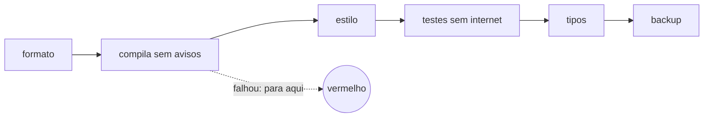

# FAB-201 · Montar o ambiente e a verificação em um comando

> ✅ Concluída · Etapa **E2 — Fundação do sistema** · Pacote 2.1 · História · R12

## A ideia

Ter um único comando que diz se o projeto está saudável. Em vez de lembrar de rodar várias checagens, `mix factory.ci` roda todas em ordem — da mais barata para a mais cara — e para na primeira que falhar. (`mix` é a ferramenta de linha de comando do Elixir, como `npm` ou `make`.)

## Visão geral



## O que foi feito

Cria o projeto Phoenix/Elixir e uma bateria de verificação acionada por um único comando, `mix factory.ci`. Ela roda, em ordem, formatação, compilação sem avisos, Credo estrito, testes, Dialyzer e o teste de backup, e para no primeiro estágio que falhar.

## Por que existe

Garante R12 (verificação automática e reproduzível): o critério de 'pronto' do próprio sistema é um comando declarado em arquivo, não algo lembrado de cabeça.

## Como foi feito

- Os estágios ficam declarados em `_management/ci.json` — o arquivo é a fonte da verdade
- `Factory.CI.stages/1` lê o arquivo; `Factory.CI.run/2` aplica a regra 'primeira falha para o resto'
- `run/2` recebe a função que executa o estágio, então a regra é testável sem rodar comandos reais
- Modo rápido pula estágios caros (Dialyzer) e os reporta como SKIPPED, em vez de omiti-los

**Exemplo:** se `mix compile --warnings-as-errors` falha, Credo, testes e Dialyzer nem chegam a rodar e o relatório mostra onde parou.

## Critérios de aceite

- [x] `mix factory.ci` roda todos os estágios, do mais barato ao mais caro
- [x] O primeiro estágio que falhar interrompe os seguintes

## Como verificar

```bash
mix test test/mix/ci_test.exs
mix factory.ci
```

## Onde está no código

`Factory.CI` · `Mix.Tasks.Factory.Ci` · `Factory.Application` · `Factory.Repo`

## Commits

- chore: scaffold the Phoenix application (FAB-201)
- feat(ci): add one-command verification with mix factory.ci (FAB-201)
