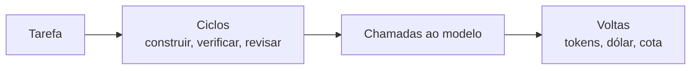

# FAB-202 · Criar o banco de dados e a contagem de custo

> ⬜ A fazer · Etapa **E2 — Fundação do sistema** · Pacote 2.2 · História · R10

## A ideia

Guardar todo o estado do sistema num banco relacional (PostgreSQL) e gravar o custo de cada conversa com o modelo de IA, volta por volta. Assim o custo de qualquer tarefa é uma soma, e o próprio banco recusa dados inválidos (como um status inventado).

## Visão geral



## O que foi feito

Cria o banco PostgreSQL do sistema: projetos, especialistas, tarefas, dependências, áreas, critérios, ciclos, despachos e consumo por volta. Também cria a tabela de preços e a conta de custo de cada volta do modelo, em duas unidades: cota da assinatura e dólar estimado.

## Por que existe

Garante R10 (custo medido e consultável): o banco é a verdade do estado, e cada volta grava seu consumo, então o custo de qualquer ciclo é uma consulta, não uma estimativa.

## Como foi feito

- Seis estados + dois terminais em `Factory.Tasks.Task` como `Ecto.Enum`: estado inventado não chega ao banco
- `Factory.Tasks.Cycle` nunca é sobrescrito: cada retrabalho é uma linha nova, e o custo por ciclo fica separável
- `Factory.Tasks.Usage` grava uma linha por volta, separando entrada, leitura e escrita de cache, saída
- `Factory.Cost.Pricing.estimate/2` e `quota_units/2` calculam dólar e cota; preços datados por `checked_on/0`
- `Factory.Tasks.Area` guarda um arquivo por linha, nunca diretório, para a interseção de áreas ser exata

**Exemplo:** uma volta com 10 mil tokens lidos do cache custa 0,1× o preço de entrada; uma escrita de cache com TTL de 1h custa 2,0×.

## Critérios de aceite

- [ ] Migrações criam todas as tabelas
- [ ] Cada consumo grava tokens, cota e custo em dólar
- [ ] O custo de um ciclo é consultável

## Como verificar

```bash
mix test test/factory/schema_test.exs
mix test test/factory/cost/pricing_test.exs
```

## Onde está no código

`Factory.Tasks.Task` · `Factory.Tasks.Cycle` · `Factory.Tasks.Dispatch` · `Factory.Tasks.Usage` · `Factory.Tasks.Area` · `Factory.Tasks.Criterion` · `Factory.Tasks.Dependency` · `Factory.Projects.Project` · `Factory.Projects.Specialist` · `Factory.Cost.Pricing` · `Factory.Cost.Usage`
