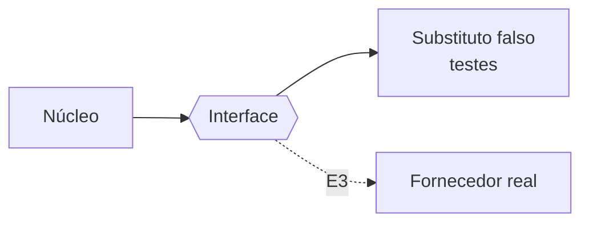

# FAB-203 · Criar as fronteiras do modelo e da busca, com substitutos de teste

> ✅ Concluída · Etapa **E2 — Fundação do sistema** · Pacote 2.3 · História · R12, R15

## A ideia

O núcleo do sistema não conhece o fornecedor do modelo de IA: conhece só uma interface (uma "tomada"). Atrás dela fica, nos testes, um substituto falso — grátis, sem internet e previsível — e, a partir da E3, os fornecedores reais. São duas tomadas: o Provider (conversa com o modelo) e o Embedder (transforma texto em vetor de números, para a memória buscar por significado na E6).

## Visão geral



## O que foi feito

Define duas fronteiras (behaviours do Elixir): uma para o fornecedor do modelo de linguagem (`Factory.Provider`) e outra para o gerador de embeddings (`Factory.Embedder`). Cada uma vem com um adaptador falso e determinístico, que é o padrão no ambiente de teste.

## Por que existe

Garante R12 e R15: toda a governança fica do lado de cá da fronteira e é testada sem rede nem custo; trocar de fornecedor é trocar o adaptador, sem mexer no núcleo.

## Como foi feito

- `Factory.Provider.chat/2` é uma única volta síncrona; repetir e contar voltas é do laço do agente, não do adaptador
- `Factory.Provider.Fake` responde a partir de um roteiro declarado pelo teste e devolve `{:error, :script_exhausted}` quando acaba — nunca inventa resposta
- `Factory.Embedder.Fake` gera vetores por hash: mesmo texto, mesmo vetor; textos diferentes, vetores diferentes
- A configuração de teste aponta `:provider` e `:embedder` para os falsos

**Exemplo:** um teste roteiriza duas respostas; a terceira chamada recebe `{:error, :script_exhausted}` em vez de travar.

## Critérios de aceite

- [x] Nenhum teste fala com o fornecedor do modelo
- [x] Os adaptadores falsos são o padrão no ambiente de teste

## Como verificar

```bash
mix test test/factory/provider/fake_test.exs
mix test test/factory/embedder/fake_test.exs
mix test test/factory/embedder_test.exs
```

## Onde está no código

`Factory.Provider` · `Factory.Provider.Fake` · `Factory.Embedder` · `Factory.Embedder.Fake`

## Commits

- feat(provider): add the Provider boundary and its deterministic fake (FAB-203)
- feat(embedder): add the Embedder boundary and its hash-vector fake (FAB-203)
