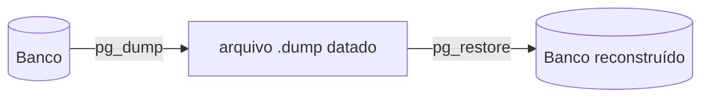

# FAB-204 · Cópia de segurança do banco

> ✅ Concluída · Etapa **E2 — Fundação do sistema** · Pacote 2.4 · História

## A ideia

Conseguir copiar o banco inteiro e reconstruí-lo, com prova de que funciona. O PostgreSQL traz duas ferramentas: `pg_dump` copia o banco para um arquivo; `pg_restore` reconstrói o banco a partir dele. O teste faz a ida e a volta de verdade.

## Visão geral



## O que foi feito

Adiciona `mix factory.backup` (gera um dump do banco) e `mix factory.restore` (restaura um dump, inclusive o mais recente com `--latest`). A ida e volta é provada por um teste que roda num estágio próprio da verificação.

## Por que existe

Como todo o estado do sistema vive no banco, não perder trabalho exige cópia restaurável; o teste garante que o backup não é só um arquivo que parece válido.

## Como foi feito

- `Factory.Backup.dump/1` e `restore/2` chamam `pg_dump`/`pg_restore` em formato custom
- O caminho dos binários vem de `config :factory, :pg_bin`, nunca do PATH: cliente de versão errada gera dump que falha só na restauração
- Restauração usa `--clean --if-exists`, então é repetível
- O teste roda isolado como estágio `backup` (`mix test.backup`), fora da suíte comum

**Exemplo:** grava dados, faz dump, apaga, restaura e confere que os dados voltaram iguais.

## Critérios de aceite

- [x] Backup e restauração preservam os dados
- [x] O teste de ida e volta roda isolado do resto da suíte

## Como verificar

```bash
mix test.backup
```

## Onde está no código

`Factory.Backup` · `Mix.Tasks.Factory.Backup` · `Mix.Tasks.Factory.Restore`

## Commits

- feat(backup): add mix factory.backup and mix factory.restore (FAB-204)
- ci: run the backup round trip as an isolated stage (FAB-204)
