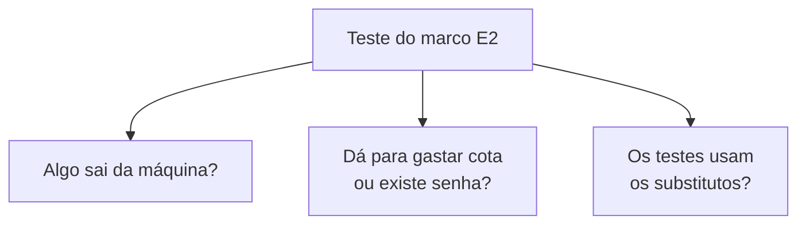

# FAB-205 · MARCO E2 — a suíte roda sem internet e sem cota

> ✅ Concluída · Etapa **E2 — Fundação do sistema** · Pacote Marco · Marco · R12

## A ideia

Um arquivo de testes automáticos (`test/factory/milestone_e2_test.exs`) cuja missão é provar a entrega da etapa: os testes rodam sem internet e sem consumir o serviço do modelo. Ele roda em toda verificação — se alguém abrir caminho para a internet ou para uma senha, ele quebra.

## Visão geral



## O que foi feito

Marco da etapa 2: um teste permanente que prova que a suíte inteira roda sem internet, sem consumir cota e sem chave de API. Ele não é executado só uma vez — roda em toda verificação, para o marco não ficar falso com a próxima dependência.

## Por que existe

Garante R12: testar a governança não pode gastar dinheiro nem depender do fornecedor; se alguém adicionar um cliente HTTP ou ler uma chave fora do lugar, a suíte quebra.

## Como foi feito

- Toda requisição HTTP passa por um porteiro que explode nos testes; o teste tenta chamar a API real e confere a explosão
- Nenhuma outra biblioteca de rede está carregada e nenhum código abre conexão por baixo
- Nenhum código lê variáveis de ambiente nem cita o nome da chave de acesso; nenhum arquivo contém algo com formato de chave
- As variáveis de chave não existem no ambiente dos testes
- O Provider e o Embedder configurados são os falsos; nenhuma biblioteca de modelo local está carregada

**Exemplo:** um `Req.get!` para `api.anthropic.com` durante a suíte levanta 'tried to LEAVE during the test suite'.

## Critérios de aceite

- [x] `mix test test/factory/milestone_e2_test.exs` passa
- [x] Roda em toda verificação, não só no dia do marco

## Como verificar

```bash
mix test test/factory/milestone_e2_test.exs
```

## Onde está no código

`Factory.MilestoneE2Test` · `Factory.NoNetwork`

## Commits

- test: prove the suite runs with no network, quota or API key (FAB-205)
