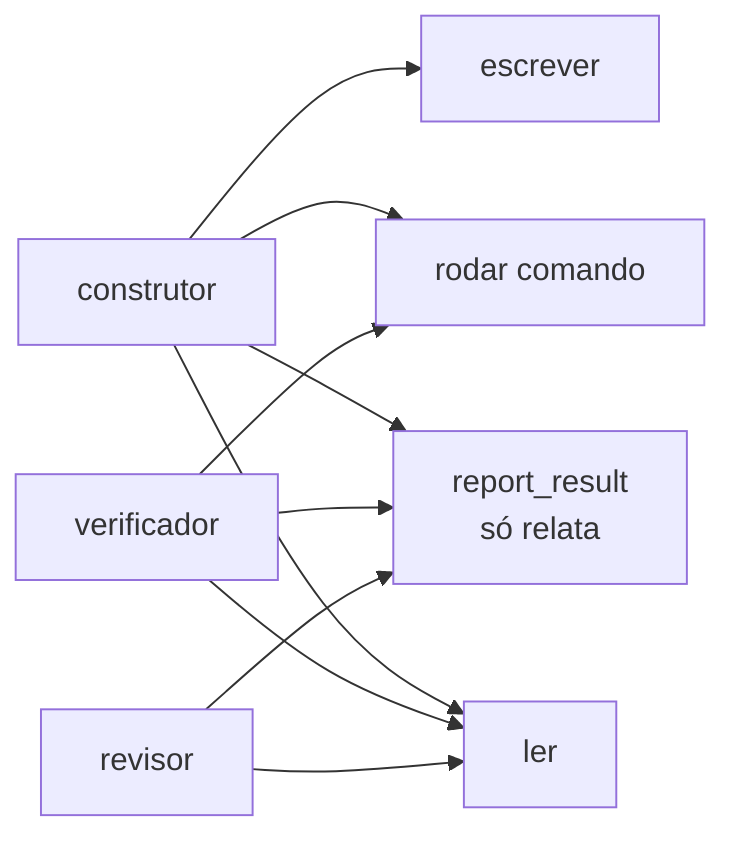

# FAB-301 · Ferramentas de arquivo e de comando

> ✅ Concluída · Etapa **E3 — O agente e as ferramentas** · Pacote 3.1 · História

## A ideia

Dar ao agente as suas "mãos": ferramentas para ler, listar, buscar, escrever e editar arquivos e para rodar comandos. Quem executa é sempre o sistema. Cada papel recebe só as ferramentas de que precisa, e nenhum recebe uma ferramenta para mudar o estado da tarefa — o agente só relata o que fez.

## Visão geral



## O que foi feito

Cria as ferramentas que o agente usa: ler, listar, buscar, escrever e editar arquivos, e rodar comandos externos com prazo. Quando o prazo estoura, o sistema mata a árvore inteira de processos, não só o processo lançado. Inclui o catálogo de ferramentas por papel e a ferramenta `report_result`.

## Por que existe

A governança aparece como ausência: nenhum papel recebe ferramenta que altere o estado ou as tentativas da tarefa, e verificador e revisor não recebem escrita. O agente só relata; quem muda o estado é o sistema.

## Como foi feito

- `Factory.Tools.Command` usa `Port` com `:spawn_executable` (expõe o PID do SO) e devolve stdout e stderr separados
- `Factory.Tools.ProcessTree.kill/1` usa `taskkill /T /F` no Windows e sinal ao grupo de processos no Unix
- `Factory.Tools.Files.edit/4` é substituição exata: recusa se o trecho aparece zero ou mais de uma vez
- `Factory.Tools.Catalog.for_role/1` define as ferramentas de cada papel; um teste falha se alguma puder escrever estado
- `Factory.Tools.ReportResult` descarta campos fora da lista permitida e avisa na mesma resposta

**Exemplo:** um `mix test` que trava além do prazo é encerrado junto com o `erl` filho, e o resultado vem com motivo `:timeout`, não como teste reprovado.

## Critérios de aceite

- [x] Comando que estoura o prazo é morto com todos os filhos
- [x] stdout e stderr chegam separados e completos
- [x] O agente registra o resultado sem poder mudar o estado da tarefa

## Como verificar

```bash
mix test test/factory/tools/command_test.exs
mix test test/factory/tools/files_test.exs
mix test test/factory/tools/report_result_test.exs
```

## Onde está no código

`Factory.Tools.Files` · `Factory.Tools.Command` · `Factory.Tools.ProcessTree` · `Factory.Tools.Catalog` · `Factory.Tools.ReportResult`

## Commits

- feat(tools): add file tools and a command runner that kills the process tree (FAB-301)
- feat(tools): add the per-role tool catalog and report_result (FAB-301)
