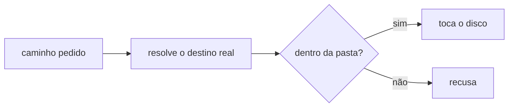

# FAB-302 · Confinamento: nenhum agente escreve fora do projeto

> ✅ Concluída · Etapa **E3 — O agente e as ferramentas** · Pacote 3.2 · História · R11

## A ideia

Garantir que nenhum agente escreva fora da pasta do projeto. Antes de tocar o disco, todo caminho é resolvido até o destino real — seguindo links e junções — e recusado se sair da pasta. Não é um pedido no prompt: é uma regra do código, e o shell do agente ainda roda numa caixa isolada do sistema operacional.

## Visão geral



## O que foi feito

Implementa o confinamento: nenhuma ferramenta de arquivo consegue ler ou escrever fora da pasta do projeto. Todo caminho é resolvido até o destino real e recusado se for absoluto, tiver `..`, link ou junção para fora, UNC ou dispositivo do Windows. Também traz guardas que julgam um comando antes de ele rodar.

## Por que existe

Garante R11 (o agente não sai do projeto) como propriedade do código, não como frase no prompt.

## Como foi feito

- `Factory.Tools.Confinement.resolve/2` normaliza, segue links até o alvo real e compara com a raiz antes de tocar o disco
- Barra invertida é separador em toda plataforma; comparação sem caixa no Windows e com caixa no resto
- `Factory.Tools.Guards.check_process/2` RECUSA comandos que matariam a própria fábrica; `check_tooling/1` só AVISA sobre roda reinventada
- Guardas são funções puras, testáveis exaustivamente
- No adaptador CLI, o shell do agente roda em sandbox do SO (sem sandbox, o agente com shell nem sobe); `priv/probes/confinement_cli.exs` prova, contra o binário real, que o CLI recusa escrever fora da raiz

**Exemplo:** um caminho `../../etc/passwd` ou `CON` é recusado com erro antes de qualquer leitura ou escrita.

## Critérios de aceite

- [x] Caminho fora da raiz é recusado antes de tocar o disco
- [x] Links e junções são seguidos até o destino real
- [x] Sem sandbox, o agente com shell nem sobe

## Como verificar

```bash
mix test test/factory/tools/confinement_test.exs
mix test test/factory/tools/guards_test.exs
mix factory.syntax priv/probes/confinement_cli.exs
```

## Onde está no código

`Factory.Tools.Confinement` · `Factory.Tools.Guards`

## Commits

- feat(tools): confine every file and command path to the project root (FAB-302)
- feat(tools): add guards against dangerous commands and calls (FAB-302)
