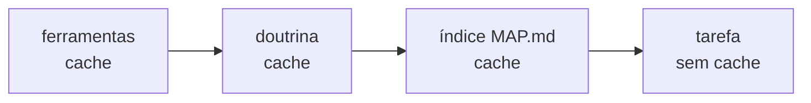

# FAB-303 · Resumo do projeto para orientar o agente

> ⬜ A fazer · Etapa **E3 — O agente e as ferramentas** · Pacote 3.1 · História

## A ideia

Dar ao agente um resumo do projeto para ele se orientar sem ler todo o código: um índice com a árvore de arquivos e as funções públicas de cada módulo. E montar a parte fixa do pedido ao modelo sempre igual, byte a byte, para o fornecedor reaproveitar o cache e cobrar menos.

## Visão geral



## O que foi feito

Gera um índice denso do projeto (`_management/MAP.md`): árvore de arquivos, símbolos públicos e o propósito de cada um, para o agente se orientar sem ler o código inteiro. Também monta a parte estável do prompt em faixas fixas, com um ponto de cache por faixa.

## Por que existe

Reduz o contexto e o custo por despacho: o cache do fornecedor só vira leitura barata se o prefixo for idêntico byte a byte entre despachos.

## Como foi feito

- `Factory.Index.CodeMap.extract/1` usa a AST (`Code.string_to_quoted/2`), nunca regex
- Saída sem data, hash ou contador: duas gerações sobre a mesma árvore dão bytes idênticos
- `Factory.Prompt.Prefix.build/2` ordena as faixas: ferramentas → doutrina → índice (com cache) → tarefa (sem cache)
- Avisa quando o prefixo fica abaixo do mínimo cacheável do modelo (512/1024/4096 tokens)
- `mix factory.map` grava o índice

**Exemplo:** rodar `mix factory.map` duas vezes sem mudar código produz o mesmo arquivo, então o prefixo continua no cache.

## Critérios de aceite

- [ ] `mix factory.map` gera o índice de forma determinística
- [ ] O prefixo tem faixas estáveis e um ponto de cache por faixa

## Como verificar

```bash
mix test test/factory/index/code_map_test.exs
mix test test/factory/prompt/prefix_test.exs
mix factory.map
```

## Onde está no código

`Factory.Index.CodeMap` · `Factory.Prompt.Prefix` · `Factory.Prompt.Block` · `Mix.Tasks.Factory.Map`
