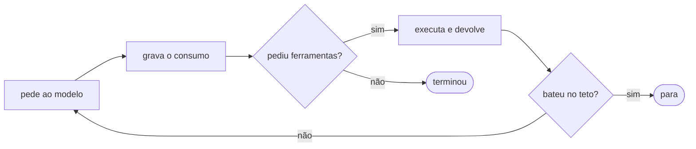

# FAB-304 · O agente como processo supervisionado, com limite de chamadas

> ⬜ A fazer · Etapa **E3 — O agente e as ferramentas** · Pacote 3.3 · História

## A ideia

Construir o coração do agente: um laço que pede ao modelo, executa as ferramentas pedidas, devolve os resultados e repete até o modelo terminar. Os limites (número de voltas e gasto) ficam no próprio processo, então o modelo não tem como ignorá-los — e o custo de cada volta é gravado antes de seguir.

## Visão geral



## O que foi feito

Implementa o núcleo do agente: o laço que monta a requisição, chama o modelo, executa as ferramentas pedidas e repete até o modelo terminar ou um teto ser atingido. O laço é um processo OTP (GenServer), que pode ser supervisionado e encerrado de fora.

## Por que existe

Os tetos de voltas e de gasto vivem no estado do processo, não no prompt: o modelo não decide se continua, então não pode ignorar o limite.

## Como foi feito

- `Factory.Agents.Loop.run/1` devolve todos os resultados de ferramenta numa só volta
- Ferramenta que falha devolve `error: true` em vez de sumir
- Cada volta grava consumo ANTES de decidir continuar, inclusive em erro que já gastou tokens
- `Factory.Agents.State.check_continue/1` aplica os tetos; `Factory.Agents.ToolBudget` mede chamadas por papel (meta e limiar p90)
- `ToolBudget` mede e nunca corta: interromper no meio custa igual e não entrega nada

**Exemplo:** com teto de 30 voltas, a 31ª não acontece mesmo que o modelo peça mais uma ferramenta.

## Critérios de aceite

- [ ] Cada volta grava uma linha de consumo
- [ ] O teto de chamadas por papel é imposto
- [ ] A raiz do projeto chega ao executor em toda volta

## Como verificar

```bash
mix test test/factory/agents/loop_test.exs
mix test test/factory/agents/tool_budget_test.exs
```

## Onde está no código

`Factory.Agents.Loop` · `Factory.Agents.State` · `Factory.Agents.ToolBudget`
