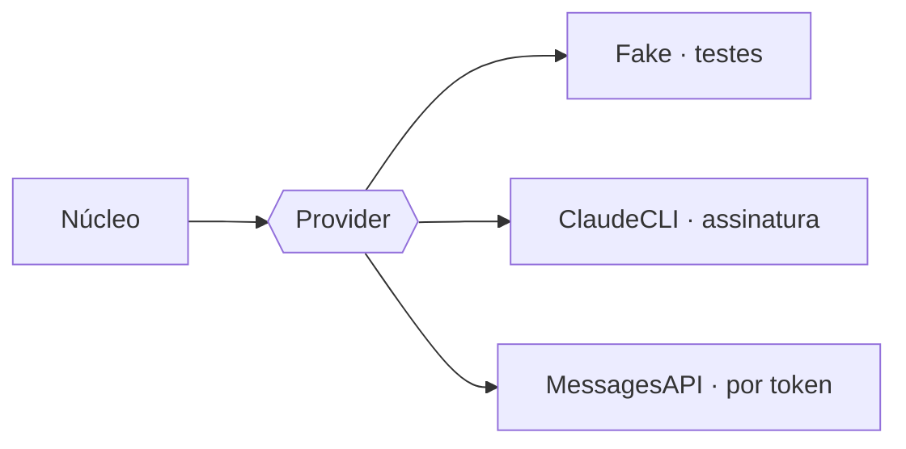

# FAB-305 · Adaptadores do fornecedor, com o controle medido antes

> ⬜ A fazer · Etapa **E3 — O agente e as ferramentas** · Pacote 3.4 · História · R15

## A ideia

Ligar fornecedores reais na tomada criada na E2: um que dirige o programa de linha de comando do fornecedor (usa a assinatura) e outro que fala direto com a API (paga por token e controla o cache). O núcleo não muda. As regras de segurança do programa de linha de comando foram medidas contra o programa real antes de serem decididas.

## Visão geral



## O que foi feito

Cria dois adaptadores reais atrás da mesma fronteira `Factory.Provider`: um que dirige o CLI do Claude Code (roda na assinatura, consome cota) e outro que fala HTTP direto com a API de mensagens (paga por token, com controle de cache). As regras de governança do CLI foram medidas contra o binário real antes de decidir.

## Por que existe

Garante R15 (independência de fornecedor): trocar de adaptador não muda o núcleo, e a governança é imposta na linha de comando e auditada na saída.

## Como foi feito

- `Factory.Provider.ClaudeCLI` usa `--permission-mode acceptEdits` e fecha o vocabulário com `--tools`
- Shell só com sandbox do SO obrigatória; indisponível → `{:error, :sandbox_unavailable}`
- `ClaudeCLI.parse/2` audita cada caminho de `tool_use` via `Confinement.resolve/2` e reconhece a parede de cota
- `Factory.Provider.MessagesAPI` usa `Req` puro e põe `cache_control` com TTL 1h no fim de cada faixa estável
- Probes em `priv/probes/` (`cli_governance.exs`, `cli_real.exs`) medem o comportamento do binário real

**Exemplo:** se o CLI escreveu um arquivo fora da raiz, a resposta vira `{:error, {:outside_confinement, paths}}`, com o consumo já pago registrado.

## Critérios de aceite

- [ ] Trocar de adaptador não muda o núcleo
- [ ] Permissões, vocabulário de ferramentas e teto de turnos do CLI são aplicados
- [ ] O custo real do despacho bate com o do fornecedor

## Como verificar

```bash
mix test test/factory/provider/claude_cli_test.exs
mix test test/factory/provider/messages_api_test.exs
mix factory.syntax priv/probes/cli_governance.exs
mix factory.syntax priv/probes/cli_real.exs
```

## Onde está no código

`Factory.Provider.ClaudeCLI` · `Factory.Provider.MessagesAPI`
