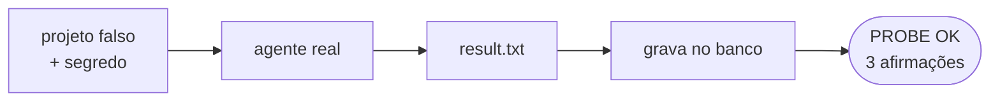

# FAB-306 · MARCO E3 — um agente real resolve uma tarefa real, com o custo gravado

> ✅ Concluída · Etapa **E3 — O agente e as ferramentas** · Pacote Marco · Marco · R15

## A ideia

Provar a entrega da etapa com o modelo de verdade: um agente real recebe uma tarefa real num projeto de mentira — criar um arquivo com um segredo gerado na hora — e resolve. Depois o script confere que o custo ficou gravado no banco, uma linha por volta, com a soma batendo.

## Visão geral



## O que foi feito

Marco da etapa 3: um script (probe) que roda um agente contra o modelo REAL, num projeto falso, pedindo que ele crie um arquivo com um conteúdo secreto. Depois confere que a tarefa foi resolvida e que o custo ficou gravado corretamente no banco.

## Por que existe

Garante R15 e R10 com o fornecedor de verdade: o laço, o adaptador CLI e a contabilidade por volta funcionam juntos fora dos testes simulados.

## Como foi feito

- 1. Cria uma pasta temporária com 3 arquivos e um segredo único gerado na hora
- 2. Roda `Factory.Agents.Loop` com `Provider.ClaudeCLI` e só a ferramenta `write` (não depende de sandbox)
- 3. Grava ciclo, despacho e uma linha de consumo por volta numa única transação (`Ecto.Multi`)
- 4. Afirmação 1: `result.txt` existe no disco e contém o segredo pedido
- 5. Afirmações 2 e 3: uma linha em `usages` por volta, e a soma de tokens no banco igual à soma no estado do laço; imprime PROBE OK

**Exemplo:** consome cota da assinatura; por isso é um probe manual e não faz parte de `mix test`.

## Critérios de aceite

- [x] `mix run priv/probes/milestone_e3_agent.exs` imprime PROBE OK
- [x] As três afirmações passam: tarefa resolvida, uma linha por volta, soma igual

## Como verificar

```bash
mix factory.syntax priv/probes/milestone_e3_agent.exs
mix run priv/probes/milestone_e3_agent.exs
```

## Onde está no código

`Factory.Agents.Loop` · `Factory.Provider.ClaudeCLI` · `Factory.Tasks.Transition`

## Commits

- test: add the E3 milestone probe against the real model (FAB-306)
