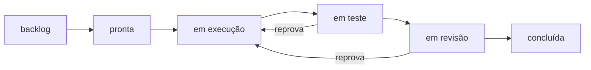

# FAB-401 · Os seis estados, com a mudança gravada de uma vez só

> ⬜ A fazer · Etapa **E4 — Linha de produção de tarefas** · Pacote 4.1 · História · R2

## A ideia

Dar a toda tarefa a mesma linha de estados — backlog, pronta, em execução, em teste, em revisão, concluída — e fazer cada mudança gravar junto o estado, o relatório e o custo. Ou tudo entra, ou nada entra; e o contador de tentativas é do sistema, nunca do agente.

## Visão geral



## O que foi feito

Implementa a máquina de estados das tarefas (backlog → pronta → execução → teste → revisão → concluída, mais bloqueada e cancelada) e a transição transacional. Mudar de estado grava, numa única transação, o novo estado, o relatório do ciclo, o despacho e o consumo — ou nada.

## Por que existe

Garante R2 (ciclo de vida com estados fixos): nenhum caminho grava estado sem checar a regra, e o contador de tentativas é incrementado pelo sistema, nunca pelo agente.

## Como foi feito

- `Factory.Tasks.StateMachine` é pura: `can?/2`, `check/2`, `targets/1` sobre o mapa de transições legais
- `Factory.Tasks.Transition.apply/3` monta um `Ecto.Multi` com status, ciclo, despacho e N linhas de consumo
- Entrar em `in_progress` incrementa `attempts` na mesma transação (`hands_to_builder?/1`)
- A linha da tarefa é lida `FOR UPDATE`, então transições concorrentes na mesma tarefa se serializam

**Exemplo:** `done → in_progress` é recusada: desfazer trabalho aprovado exige uma tarefa nova.

## Critérios de aceite

- [ ] Transição inválida é recusada
- [ ] Estado, ciclo, despacho e consumo gravados numa transação
- [ ] O contador de tentativas é do sistema

## Como verificar

```bash
mix test test/factory/tasks/state_machine_test.exs
mix test test/factory/tasks/transition_test.exs
```

## Onde está no código

`Factory.Tasks.StateMachine` · `Factory.Tasks.Transition`
