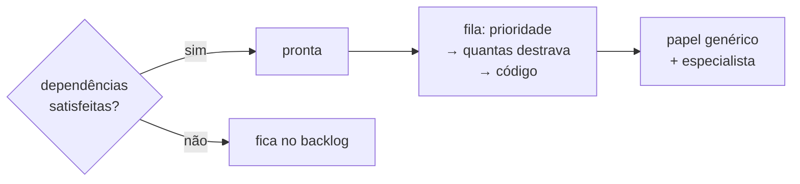

# FAB-402 · Fila por dependências e equipe especializada

> ⬜ A fazer · Etapa **E4 — Linha de produção de tarefas** · Pacote 4.2 · História

## A ideia

Decidir por regra, e não por palpite, quando uma tarefa pode começar (todas as dependências satisfeitas) e qual vai primeiro (a que destrava mais trabalho). E decidir quem a constrói: o papel genérico, mais um especialista quando a tarefa aponta para um.

## Visão geral



## O que foi feito

Cria o escalonador: decide quais tarefas passam a 'pronta' (todas as dependências concluídas) e em que ordem a fila é despachada. Também cria a equipe de especialistas versionada e a regra que decide quem constrói cada tarefa: o papel genérico mais, opcionalmente, um especialista.

## Por que existe

Tira do modelo decisões que cabem num teste (promoção e ordem) e mantém a disciplina do papel sempre presente, com o especialista apenas acrescentando conhecimento de domínio.

## Como foi feito

- `Factory.Tasks.Scheduler.promote/1`: dependência cancelada só conta se todas as substitutas estiverem satisfeitas; bloqueada nunca conta
- `Scheduler.next_steps/2` ordena por prioridade, depois por quantas tarefas abertas cada uma destrava, depois por código
- `Factory.Team.define/2` desativa a versão antiga e insere a nova numa transação (índice único parcial `where: active`)
- `Factory.Team.Resolution.resolve/3` dá dois resultados: papel sozinho ou papel + especialista; especialista inexistente é registrado como defeito

**Exemplo:** em empate de prioridade, a tarefa que destrava três outras vai antes da que não destrava nenhuma.

## Critérios de aceite

- [ ] Tarefa só fica pronta com todas as dependências concluídas
- [ ] Empate na fila: primeiro a que destrava mais tarefas
- [ ] O especialista soma ao papel, não o substitui

## Como verificar

```bash
mix test test/factory/tasks/scheduler_test.exs
mix test test/factory/team/resolution_test.exs
```

## Onde está no código

`Factory.Tasks.Scheduler` · `Factory.Team` · `Factory.Team.Resolution`
