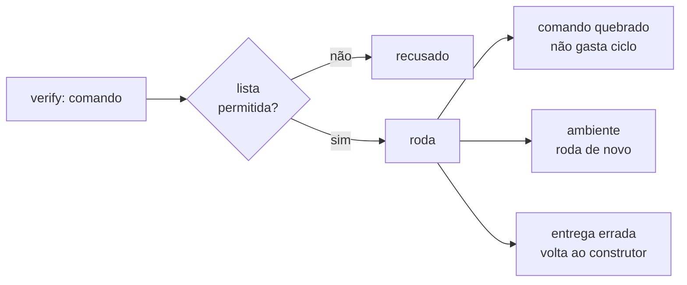

# FAB-403 · Critérios de aceite executados sozinhos

> ✅ Concluída · Etapa **E4 — Linha de produção de tarefas** · Pacote 4.3 · História

## A ideia

Rodar sozinho, antes de chamar qualquer agente, todo critério que tem um comando — só de uma lista permitida — e dizer de quem é a culpa quando falha: do comando, da máquina ou da entrega.

## Visão geral



## O que foi feito

Executa sozinho, antes de gastar um despacho de agente, todo critério de aceite que tem comando (`verify:`). Só roda binários de uma lista permitida e classifica cada falha: comando quebrado, problema de ambiente ou entrega errada. A suíte de testes do projeto entra sempre como critério implícito.

## Por que existe

Separa 'o comando está errado' de 'a entrega está errada': sem isso, o construtor — que não pode mudar critérios — seria despachado de novo para consertar o que já estava certo, queimando ciclos.

## Como foi feito

- `Factory.Criteria.run/3` executa; comandos repetidos rodam uma vez e o segundo vira espelho
- `Factory.Criteria.Allowlist.check/1` é lista permitida (falha fechada): `git` só leitura, `npx` excluído
- `Factory.Criteria.FailureClass.classify/1`: `:broken_tool` e `:environment` não gastam ciclo; `:delivery` gasta; na dúvida, `:delivery`
- `Factory.Criteria.Suite` pega o comando de testes de `_management/ci.json` ou detecta pelo ecossistema (`Factory.Ecosystems`)
- O relatório rotula cada critério e fecha com a linha `Proof levels:`

**Exemplo:** um critério `git push` é recusado sem rodar; um `mix test` cujo arquivo-alvo não existe conta como entrega reprovada.

## Critérios de aceite

- [x] Só binários da lista permitida rodam
- [x] Falha de ambiente não conta como entrega reprovada
- [x] A suíte do projeto entra como critério implícito

## Como verificar

```bash
mix test test/factory/criteria_test.exs
mix test test/factory/criteria/failure_class_test.exs
mix test test/factory/criteria/suite_test.exs
```

## Onde está no código

`Factory.Criteria` · `Factory.Criteria.Allowlist` · `Factory.Criteria.FailureClass` · `Factory.Criteria.Suite` · `Factory.Ecosystems`

## Commits

- feat(criteria): run executable acceptance criteria behind a command allowlist (FAB-403)
- test(criteria): cover failure classes and the implicit suite per ecosystem (FAB-403)
