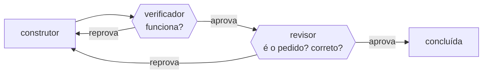

# FAB-404 · Os dois portões

> ✅ Concluída · Etapa **E4 — Linha de produção de tarefas** · Pacote 4.4 · História · R3

## A ideia

Separar duas perguntas em dois portões que não escrevem nada: o verificador pergunta "funciona?"; o revisor pergunta "é o que foi pedido?" e "está correto?". Quem constrói nunca aprova.

## Visão geral



## O que foi feito

Cria os dois portões que toda entrega atravessa: o verificador ('funciona?', executando os critérios) e o revisor ('é o que foi pedido?' e 'está correto?', lendo o diff). Nenhum dos dois recebe ferramenta de escrita.

## Por que existe

Garante R3 (dois portões independentes): um portão que pode consertar o que reprova deixa de ser portão, e conformidade é julgada separada de defeito.

## Como foi feito

- `Factory.Gates.Verifier.judge/1` só aprova se nenhum critério falhou; `:inconclusive` bloqueia — 'não sei' nunca vira 'sim'
- `Factory.Gates.Reviewer.judge/2` reprova por não conformidade mesmo com zero achados
- Achados no formato `[severidade] arquivo:linha — problema`, lidos por `parse_findings/1`
- O módulo do revisor não lê o disco (um teste varre o fonte); só recebe o diff commitado

**Exemplo:** uma entrega que passa em todos os critérios mas implementa outra coisa sai 'não conforme, zero achados' e volta para execução.

## Critérios de aceite

- [x] Os dois portões reprovam por motivos diferentes
- [x] Reprovação por conformidade não exige defeito
- [x] Achados do revisor reprovam mesmo quando registrados pela ferramenta de resultado

## Como verificar

```bash
mix test test/factory/gates_test.exs
mix test test/factory/gates/reviewer_test.exs
```

## Onde está no código

`Factory.Gates.Verifier` · `Factory.Gates.Reviewer`

## Commits

- feat(gates): add the verifier and reviewer gates with the conformance verdict (FAB-404)
