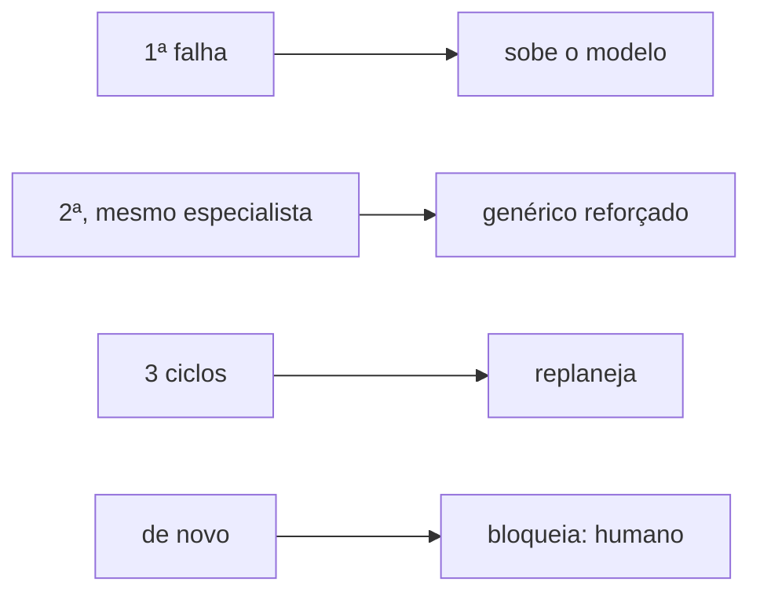

# FAB-405 · Diagnóstico da reprovação e escada de resposta

> ⬜ A fazer · Etapa **E4 — Linha de produção de tarefas** · Pacote 4.5 · História · R4, R5

## A ideia

Quando uma tarefa é reprovada, decidir COMO refazê-la: subir o modelo, trocar o construtor, replanejar ou chamar o humano — e de que tamanho é o retrabalho. Cada ciclo muda de estratégia, e o retrabalho termina.

## Visão geral



## O que foi feito

Decide COMO refazer uma tarefa reprovada, não só que ela deve ser refeita. Uma escada de quatro degraus escolhe a resposta (modelo mais forte, outro especialista, replanejar, bloquear para o humano) e um diagnóstico define o tamanho do retrabalho (escopo, número de voltas, foco).

## Por que existe

Garante R4 e R5 (limite de ciclos e autocorreção): cada ciclo muda a estratégia com base num fato gravado (o contador de tentativas), e uma tarefa impossível não gera substitutas para sempre.

## Como foi feito

- `Factory.Rework.Ladder.next_step/1`: 1ª falha sobe o modelo; 2ª com o mesmo especialista troca para o genérico reforçado; 3 ciclos → replanejar; de novo → bloquear
- Teto de 12 despachos por tarefa numa rodada como defesa em profundidade
- `Factory.Rework.Diagnosis.diagnose/2` classifica a falha: bloqueio, conformidade, funcional ou localizada
- `Factory.Rework.Policy`: estreito 8 voltas, médio 18, amplo 30

**Exemplo:** um achado menor com arquivo e linha nomeados gera um retrabalho de 8 voltas só naqueles arquivos, não uma reimplementação.

## Critérios de aceite

- [ ] Cada ciclo muda a estratégia
- [ ] No 2º ciclo o modelo sobe
- [ ] Esgotados 3 ciclos, replaneja; se já foi replanejada, bloqueia para o humano

## Como verificar

```bash
mix test test/factory/rework/ladder_test.exs
mix test test/factory/rework/diagnosis_test.exs
```

## Onde está no código

`Factory.Rework.Ladder` · `Factory.Rework.Diagnosis` · `Factory.Rework.Policy`
