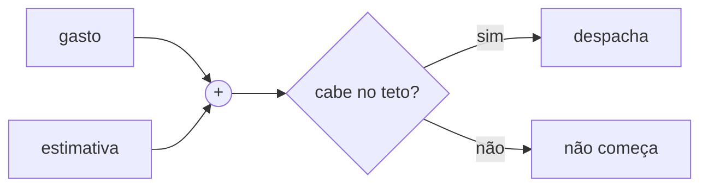

# FAB-406 · Teto de gasto por rodada e por tarefa

> ✅ Concluída · Etapa **E4 — Linha de produção de tarefas** · Pacote 4.5 · História · R14

## A ideia

Antes de começar a próxima tarefa, conferir se o gasto mais a estimativa cabem no teto. Se não cabem, não começa — e nada que já está rodando é cortado no meio.

## Visão geral



## O que foi feito

Implementa o teto de gasto: por rodada e por tarefa. Antes de despachar, o sistema verifica se o gasto acumulado mais a estimativa do próximo trabalho cabe no teto; se não cabe, não começa. Trabalho já em andamento nunca é interrompido.

## Por que existe

Garante R14 (gasto limitado): interromper um agente no meio custa o mesmo e não entrega nada, então o controle é só não COMEÇAR o que não cabe.

## Como foi feito

- `Factory.Budget.check_round/3` compara gasto + estimativa com o teto da rodada
- `Factory.Budget.task_cap/2` é uma fração do teto da rodada; `check_task/2` impede redespachar a mesma tarefa
- `estimate_next_task/1` se calibra pela média por tarefa CONCLUÍDA no próprio job, com padrão declarado na falta de medida
- Módulo puro: nenhuma função enxerga um despacho em andamento

**Exemplo:** com teto de US$ 20, gasto de US$ 15 e estimativa de US$ 7,82, a próxima tarefa não é iniciada.

## Critérios de aceite

- [x] Despacho que não cabe não começa
- [x] Trabalho em andamento nunca é interrompido pelo teto

## Como verificar

```bash
mix test test/factory/budget_test.exs
```

## Onde está no código

`Factory.Budget`

## Commits

- feat(budget): add the spending ceiling checked before each dispatch (FAB-406)
