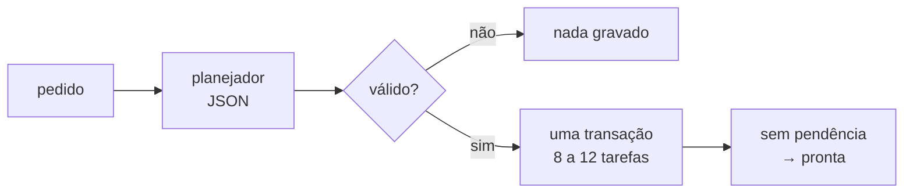

# FAB-407 · Do pedido às tarefas: o planejador

> ⬜ A fazer · Etapa **E4 — Linha de produção de tarefas** · Pacote R1 · História · R1

## A ideia

Transformar um pedido em linguagem natural num grafo de 8 a 12 tarefas, conferido antes de gravar e gravado de uma vez só. É a única porta de entrada humana do sistema.

## Visão geral



## O que foi feito

Cria o planejador: transforma um pedido em linguagem natural num grafo de 8 a 12 tarefas, com áreas, critérios e dependências, gravado no banco numa só transação; ao final, as tarefas sem pendência viram prontas. `mix factory.plan` é a única entrada humana do sistema. À parte, cria a publicação: o markdown de cada tarefa, idêntico byte a byte, e o commit restrito às áreas da tarefa.

## Por que existe

Garante R1 (do pedido às tarefas sem intervenção): plano inválido é recusado antes de tocar o banco, e nunca existe plano parcial.

## Como foi feito

- `Factory.Planner.plan/3` extrai o bloco JSON da última mensagem do agente (formato em `priv/doctrine/planner.md`)
- Recusa sem JSON válido, contagem fora de 8..12, área terminando em `/` ou ciclo de dependências
- O código `T-NNN` é atribuído pelo sistema, como status e tentativas
- `Factory.Publishing.Markdown.generate/1` é determinístico byte a byte (listas ordenadas, sem data de geração)
- `Factory.Publishing.Git.commit/3` commita só as áreas + o arquivo da tarefa e recusa se houver mudança fora delas (módulo pronto e testado; `mix factory.plan` grava no banco e não publica)

**Exemplo:** um pedido que gera um plano com dependência circular é recusado e nenhuma linha é gravada.

## Critérios de aceite

- [ ] `mix factory.plan` gera tarefas válidas a partir de um pedido
- [ ] Cada tarefa pode ser publicada em markdown determinístico e commitada só com as suas áreas

## Como verificar

```bash
mix test test/factory/planner_test.exs
mix test test/factory/publishing/markdown_test.exs
mix test test/factory/publishing/git_test.exs
mix test test/mix/plan_test.exs
```

## Onde está no código

`Factory.Planner` · `Factory.Publishing.Markdown` · `Factory.Publishing.Git` · `Factory.Projects.Phase` · `Factory.Projects.Milestone` · `Mix.Tasks.Factory.Plan`
