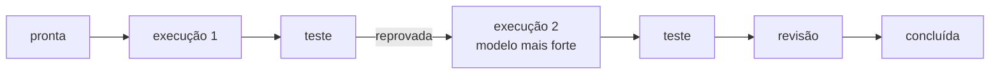

# FAB-408 · MARCO E4 — reprovada de propósito, refeita e concluída

> ✅ Concluída · Etapa **E4 — Linha de produção de tarefas** · Pacote Marco · Marco · R2, R3, R4

## A ideia

Provar a linha inteira num teste permanente: uma tarefa é reprovada de propósito por entrega errada, sobe de modelo, é refeita e conclui — com cada passo e o custo de cada ciclo gravados.

## Visão geral



## O que foi feito

Marco da etapa 4: um teste permanente em que uma tarefa percorre a linha de pronta a concluída, é reprovada de propósito por entrega errada, é refeita com modelo mais forte e conclui. Tudo é gravado por transições transacionais, sem agente real nem rede.

## Por que existe

Prova R2, R3 e R4 juntos: estados fixos, portão que reprova de verdade e escada de retrabalho que muda de estratégia.

## Como foi feito

- 1. A tarefa nasce em `ready` (o backlog exigiria dependências, provadas nos testes do escalonador); `→ in_progress`: `attempts` vira 1; o construtor entrega (`→ in_testing`) sem gastar tentativa
- 2. O verificador reprova: o critério exigia a mensagem exata 'invalid message: required field' e veio 'invalid' (`→ in_progress`, `attempts` = 2)
- 3. `Factory.Rework.Ladder.next_step/1` responde `:escalate_model`, e o modelo do ciclo 2 difere do ciclo 1
- 4. Ciclo 2: teste aprova (`→ in_review`), revisor aprova (`→ done`)
- 5. Confere o histórico pronta → execução → teste → execução → teste → revisão → concluída, um despacho de construtor por tentativa, o custo de cada ciclo consultável separadamente e o markdown da tarefa com os dois ciclos

**Exemplo:** o teste falha se o modelo do retrabalho for o mesmo da primeira tentativa.

## Critérios de aceite

- [x] `mix test test/factory/milestone_e4_test.exs` passa
- [x] Histórico: pronta → execução → teste → execução → teste → revisão → concluída
- [x] Custo por ciclo consultável separadamente

## Como verificar

```bash
mix test test/factory/milestone_e4_test.exs
```

## Onde está no código

`Factory.Tasks.Transition` · `Factory.Rework.Ladder` · `Factory.Cost.Pricing` · `Factory.Publishing.Markdown`

## Commits

- test: prove the six states, a rejection and a stronger rework end in done (FAB-408)
