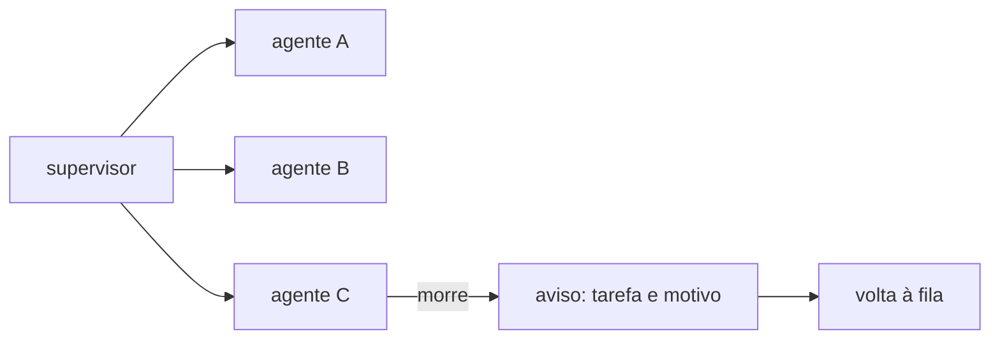

# FAB-501 · Um processo supervisionado por tarefa

> ⬜ A fazer · Etapa **E5 — Paralelismo e tolerância a falhas** · Pacote 5.1 · História · R13

## A ideia

Cada agente roda num processo próprio, com endereço e um supervisor que percebe quando ele morre. Se um cai, os outros nem percebem — e o trabalho não se perde, porque mora no banco.

## Visão geral



## O que foi feito

Cria a árvore de supervisão dos agentes em execução: cada agente é um processo Erlang isolado, com endereço (`{:agent, task_id}` num Registry) e um supervisor dinâmico. A morte de um agente não afeta os outros e é detectada na hora.

## Por que existe

Garante R13 (tolerância a falhas): o estado do trabalho vive no banco, não no processo, então um agente pode morrer a qualquer momento sem perder nada.

## Como foi feito

- `Factory.Agents.Supervisor.start_agent/4` sob `DynamicSupervisor` `:one_for_one`
- Filhos com `restart: :temporary`: reiniciar às cegas criaria um agente sem memória da conversa e pagaria de novo
- Mortes detectadas por `Process.monitor/1` (pega até `:kill`), chamando `on_crash(task_id, reason)`
- `list/0` e `stop_agent/1` consultam e encerram pelo Registry

**Exemplo:** matar o processo do agente da tarefa 7 não altera os agentes das tarefas 5 e 6, e o chamador recebe o motivo da morte.

## Critérios de aceite

- [ ] Cada agente é um processo isolado e supervisionado
- [ ] Os agentes em voo podem ser listados pelo registro

## Como verificar

```bash
mix test test/factory/agents/supervisor_test.exs
```

## Onde está no código

`Factory.Agents.Supervisor`
