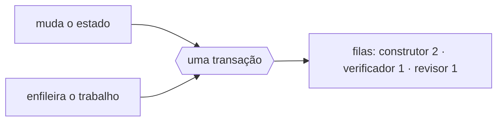

# FAB-502 · Fila durável no banco

> ⬜ A fazer · Etapa **E5 — Paralelismo e tolerância a falhas** · Pacote 5.2 · História

## A ideia

O trabalho a fazer fica numa fila dentro do próprio banco, gravada junto com a mudança de estado da tarefa: os dois existem juntos ou nenhum existe. Uma queda não apaga nada.

## Visão geral



## O que foi feito

Cria a fila durável de trabalho usando Oban, no mesmo PostgreSQL. Enfileirar o próximo passo de uma tarefa e mudar seu estado acontecem na mesma transação, e o trabalho enfileirado sobrevive a reinícios. O worker da fila é quem sobe o agente e aplica o julgamento do papel.

## Por que existe

Evita o estado impossível 'em execução sem ninguém executando': ou o job e a mudança de estado existem juntos, ou nenhum dos dois.

## Como foi feito

- `Factory.Queue.Worker.dispatch/3` enxerta `Transition.append/4` num `Ecto.Multi` que também insere o `Oban.Job`
- Jobs únicos por `{task_id, role}`; `max_attempts: 1` porque retentativa é da escada de retrabalho
- Exceção: parede de cota ou sandbox indisponível reagenda o mesmo job (`{:snooze, s}`) sem gastar tentativa
- `Factory.Queue.Rescue` devolve a `available` jobs presos em `executing` após queda do nó

**Exemplo:** se o nó cai no meio, o job preso volta à fila sozinho, em vez de ser descartado como esgotado.

## Critérios de aceite

- [ ] Enfileirar e mudar estado é atômico
- [ ] Trabalho enfileirado sobrevive a reinício

## Como verificar

```bash
mix test test/factory/queue/worker_test.exs
```

## Onde está no código

`Factory.Queue.Worker` · `Factory.Queue.Rescue`
