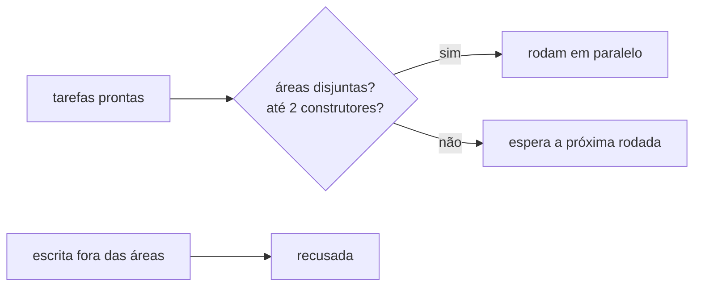

# FAB-503 · Tarefas em paralelo sem disputar arquivo

> ⬜ A fazer · Etapa **E5 — Paralelismo e tolerância a falhas** · Pacote 5.3 · História · R6, R9

## A ideia

Várias tarefas rodam ao mesmo tempo, mas duas nunca mexem no mesmo arquivo: as áreas declaradas de cada tarefa são conferidas antes de despachar e dentro da ferramenta de escrita.

## Visão geral



## O que foi feito

Permite várias tarefas em paralelo sem que duas editem o mesmo arquivo. As áreas declaradas de cada tarefa funcionam como exclusão mútua em dois pontos: antes de despachar e dentro da ferramenta de escrita. O número de agentes simultâneos respeita o perfil da máquina (8 GB).

## Por que existe

Garante R6 (paralelismo seguro) e R9 (cabe na máquina-alvo): a regra é do sistema, não uma instrução que um prompt mal escrito poderia furar.

## Como foi feito

- `Factory.Queue.Exclusion.batch/2` delega a `Scheduler.next_steps/2` e reconfere as garantias, levantando erro se alguma quebrar
- Regra: até N construtores com áreas disjuntas, verificador só com projeto quieto, revisor junto de qualquer um
- `Factory.Queue.Exclusion.allow?/2` é chamada por `Factory.Tools.Files.write/4` e `edit/5`, que devolvem `{:error, :outside_areas}`
- `all_disjoint?/1` checa a interseção arquivo a arquivo

**Exemplo:** duas tarefas que declaram `lib/a.ex` nunca saem no mesmo lote, e um agente que tenta escrever fora das suas áreas é recusado.

## Critérios de aceite

- [ ] Duas tarefas com áreas sobrepostas não rodam juntas
- [ ] O limite de agentes em voo vem do perfil da máquina

## Como verificar

```bash
mix test test/factory/queue/exclusion_test.exs
```

## Onde está no código

`Factory.Queue.Exclusion` · `Factory.Tasks.Scheduler` · `Factory.Tools.Files`
