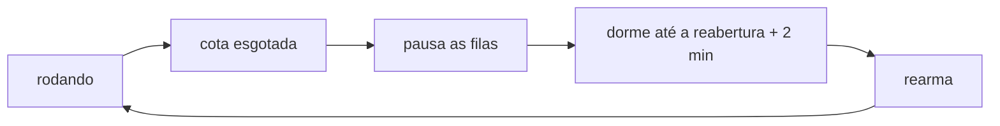

# FAB-504 · Reconhecer o limite de uso do fornecedor e retomar

> ⬜ A fazer · Etapa **E5 — Paralelismo e tolerância a falhas** · Pacote 5.4 · História

## A ideia

Quando a cota de uso acaba, o sistema não trata isso como falha: pausa as filas sem cancelar nada, dorme até o horário de reabertura e retoma sozinho.

## Visão geral



## O que foi feito

Trata o limite de uso da assinatura como um estado do sistema, não como falha de um despacho. Ao bater na cota, o sistema pausa as filas sem cancelar nada, dorme até o horário de reabertura anunciado e retoma sozinho.

## Por que existe

Sob assinatura o recurso escasso é cota, não dinheiro; sem isso, cada parede de cota seria julgada como reprovação e queimaria ciclos.

## Como foi feito

- Os adaptadores convertem a resposta do fornecedor em `{:error, {:quota, reopens_at}}`
- `Factory.Quota.hit/2` pausa as filas Oban sem tocar em `oban_jobs`
- Um timer rearma no horário de reabertura + margem; sem horário legível, backoff exponencial limitado
- `reopen_time/1` aceita também texto como '5:30pm (America/Sao_Paulo)'
- O worker reagenda (`snooze`) o despacho que bateu na parede, sem julgá-lo

**Exemplo:** às 14h a cota acaba com reabertura às 17h30: as filas pausam, os jobs ficam `available` e às 17h30 + margem tudo volta a rodar.

## Critérios de aceite

- [ ] A parede de cota é reconhecida pelo evento estruturado
- [ ] Trabalho enfileirado não é cancelado
- [ ] O despacho que bateu na parede não é julgado como reprovação

## Como verificar

```bash
mix test test/factory/quota_test.exs
```

## Onde está no código

`Factory.Quota`
