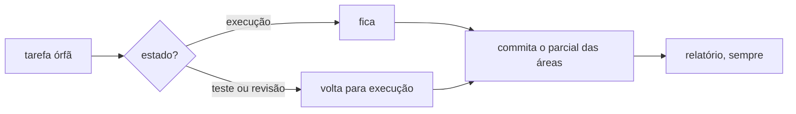

# FAB-505 · Recuperar trabalho interrompido

> ⬜ A fazer · Etapa **E5 — Paralelismo e tolerância a falhas** · Pacote 5.5 · História · R13

## A ideia

Depois de uma queda, o saneamento acha as tarefas sem agente vivo, devolve o estado delas e commita em nome de cada uma o trabalho que ficou escrito pela metade.

## Visão geral



## O que foi feito

Recupera trabalho interrompido depois de uma queda. Cruza o banco (tarefas em estado transitório) com o Registry (agentes vivos) e com o git (arquivos alterados e não commitados), e commita o trabalho parcial em nome da tarefa certa.

## Por que existe

Garante R13: nada se perde em silêncio. Um portão que morreu deixou veredito desconhecido, nunca favorável, então volta para execução.

## Como foi feito

- `Factory.Recovery.reconcile/1` acha tarefas em `in_progress`/`in_testing`/`in_review` sem agente vivo (órfãs)
- `in_progress` fica como está (já é despachável como construtor); teste e revisão voltam a `in_progress` com resultado `recovery`
- Mudanças não commitadas nas áreas da órfã são commitadas via `Factory.Publishing.Git.commit/3`
- Sempre devolve um relatório, mesmo vazio: limpeza que só fala quando acha algo não se distingue de uma quebrada

**Exemplo:** um construtor morto deixou `c.txt` sem commit; o saneamento commita o arquivo com uma mensagem que cita a tarefa e 'recovery'.

## Critérios de aceite

- [ ] O saneamento sempre reporta, mesmo sem nada a fazer
- [ ] Trabalho parcial é commitado em nome da tarefa certa

## Como verificar

```bash
mix test test/factory/recovery_test.exs
```

## Onde está no código

`Factory.Recovery`
