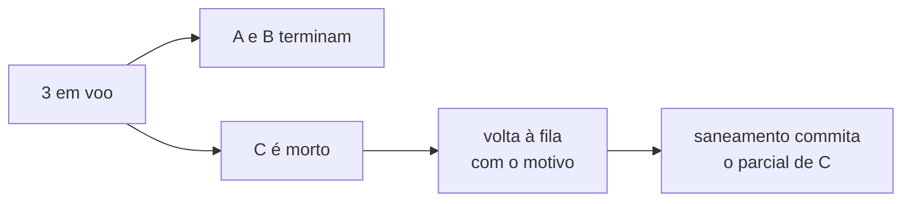

# FAB-506 · MARCO E5 — três em paralelo, e matar uma não derruba as outras

> ⬜ A fazer · Etapa **E5 — Paralelismo e tolerância a falhas** · Pacote Marco · Marco · R6, R13

## A ideia

A prova da etapa: três agentes de verdade rodando ao mesmo tempo; um é morto no meio, os outros dois terminam, e o morto volta à fila sem perder nada.

## Visão geral



## O que foi feito

Marco da etapa 5: um teste permanente com processos reais em que três agentes rodam ao mesmo tempo, um deles é morto no meio e os outros dois seguem. A tarefa morta volta à fila com o motivo, e o trabalho parcial dela é recuperado.

## Por que existe

Prova R6 e R13 pela composição: supervisor, exclusão por áreas, recuperação e cota funcionam juntos, não só cada um na sua suíte.

## Como foi feito

- 1. `Queue.Exclusion.batch/2` libera 3 construtores com áreas disjuntas; o Registry confirma os três em voo
- 2. A e B esperam um sinal; C escreve trabalho parcial em `c.txt` e trava — e é morto com `stop_agent/1`
- 3. A e B chegam a `in_testing`; C volta à fila com motivo, em `in_progress`, despachável como construtor
- 4. Nenhum consumo perdido (1 linha para A e B, 0 para C); `Recovery.reconcile/1` commita `c.txt` citando a tarefa
- 5. Segundo teste: um erro de cota injetado pausa as filas, o job continua `available` e o rearme retoma

**Exemplo:** depois da recuperação, `git status` do projeto fica vazio: nenhum arquivo sem dono.

## Critérios de aceite

- [ ] `mix test test/factory/milestone_e5_test.exs` passa
- [ ] A tarefa morta volta à fila com o motivo, sem perder consumo

## Como verificar

```bash
mix test test/factory/milestone_e5_test.exs
```

## Onde está no código

`Factory.Agents.Supervisor` · `Factory.Queue.Exclusion` · `Factory.Recovery` · `Factory.Quota` · `Factory.Queue.Worker`
