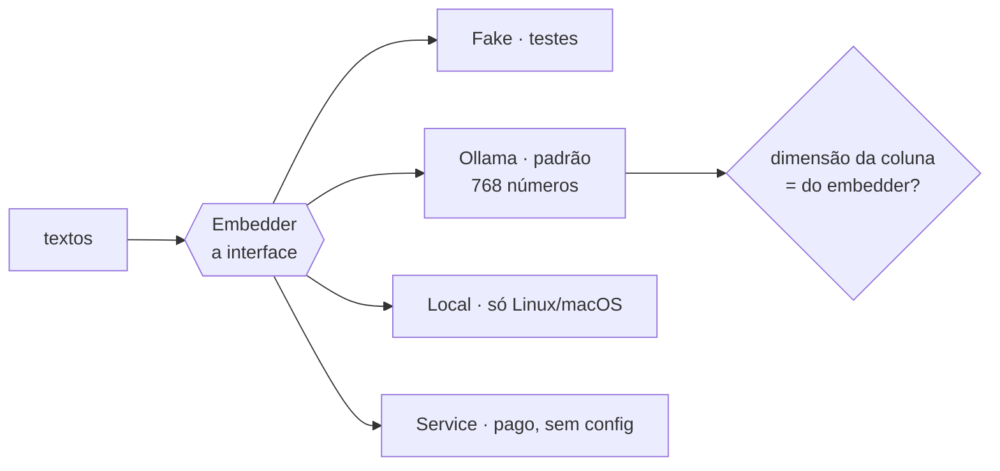

# FAB-601 · Medir antes de escolher onde a busca roda

> ⬜ A fazer · Etapa **E6 — Memória do projeto** · Pacote 6.1 · Investigação · R9

## A ideia

Antes de escolher onde o texto vira vetor, medir: o modelo dentro do Elixir pesa e não acelera no Windows, então o padrão virou o Ollama local, e a dimensão da coluna passou a ser conferida contra o embedder.

## Visão geral



## O que foi feito

Investigação (spike) para escolher onde gerar os embeddings da memória: modelo local em processo, servidor local Ollama ou serviço pago. Mediu memória e tempo e escolheu o Ollama com `embeddinggemma` como padrão. A dimensão da coluna de vetores no banco passou a ser conferida contra o embedder configurado.

## Por que existe

Contribui para R9 (roda numa máquina de 8 GB): o embedding é a única peça pesada do projeto, e a escolha foi feita com números medidos.

## Como foi feito

- `Factory.Embedder.Ollama` (padrão): prefixos diferentes para documento e consulta, exigidos pelo `embeddinggemma`
- `Factory.Embedder.Local` (Bumblebee): ~220 MB residentes; sem binário EXLA no Windows, então só atrás de `FACTORY_EMBEDDER_LOCAL=1`
- `Factory.Embedder.Service`: HTTP para serviço externo, deixado sem configuração
- `Factory.Memory.Dimension.check/0` compara a coluna `chunks.embedding` com o embedder; `align!/0` corrige
- Todo vetor devolvido é conferido: dimensão errada vira `{:error, {:invalid_dimension, ...}}`

**Exemplo:** trocar de um embedder de 384 para um de 768 dimensões é detectado por `check/0` antes de qualquer gravação.

## Critérios de aceite

- [ ] Decisão registrada com os números medidos
- [ ] Adaptador de embedding local funcionando
- [ ] A dimensão do índice segue o embedder configurado

## Como verificar

```bash
mix test test/factory/embedder/ollama_test.exs
mix test test/factory/embedder/service_test.exs
mix test test/factory/memory/dimension_test.exs
mix run priv/probes/ollama_real.exs
```

## Onde está no código

`Factory.Embedder.Ollama` · `Factory.Embedder.Local` · `Factory.Embedder.Service` · `Factory.Memory.Dimension`
