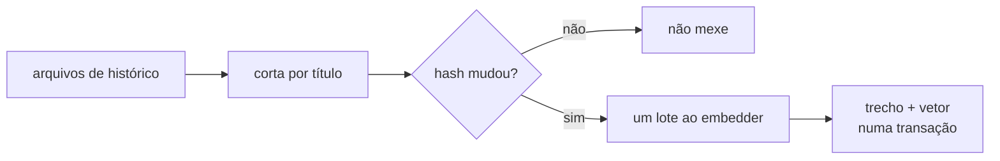

# FAB-602 · Guardar o histórico em trechos consultáveis

> ⬜ A fazer · Etapa **E6 — Memória do projeto** · Pacote 6.2 · História

## A ideia

O histórico do projeto é cortado por seção e guardado com o vetor de cada trecho; só o que é novo ou mudou paga embedding.

## Visão geral



## O que foi feito

Ingestão da memória: quebra o histórico do projeto (decisões, achados de revisão, relatórios de verificação, tarefas concluídas) em trechos por seção do markdown e grava cada trecho com seu embedding. Não indexa código — isso já é papel do índice denso.

## Por que existe

Dá ao agente acesso ao que já foi decidido no projeto, a custo baixo: só trechos novos ou alterados são reprocessados.

## Como foi feito

- `Factory.Memory.Ingestion.split/1` corta em cada título `#`..`######`, nunca dentro de bloco de código
- `process/3` compara o sha256 de cada trecho (`Factory.Memory.Chunk.hash/1`) e só embeda o que mudou
- Todos os trechos novos de uma passada vão numa única chamada `embed/1`
- `source` identifica arquivo e seção, ex.: `_management/DECISIONS.md#6.2`
- Quais arquivos entram é decisão de quem chama; nesta etapa ninguém dispara a ingestão sozinho — quem chama são os testes

**Exemplo:** reingerir o mesmo `DECISIONS.md` sem alterações não cria nenhum trecho novo.

## Critérios de aceite

- [ ] Cada seção do histórico vira um trecho consultável
- [ ] Reingerir o mesmo conteúdo não duplica trechos

## Como verificar

```bash
mix test test/factory/memory/ingestion_test.exs
```

## Onde está no código

`Factory.Memory.Ingestion` · `Factory.Memory.Chunk`
