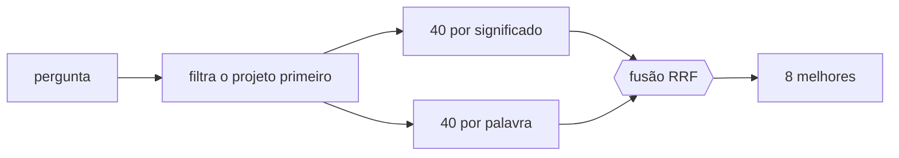

# FAB-603 · Busca por significado e por termo exato

> ⬜ A fazer · Etapa **E6 — Memória do projeto** · Pacote 6.3 · História

## A ideia

Duas buscas no mesmo projeto — por significado e por palavra exata — fundidas por posição: uma cobre o que a outra perde.

## Visão geral



## O que foi feito

Busca na memória do projeto em três modos: por significado (vetor), por termo exato (texto completo do Postgres) e híbrido, que funde os dois rankings por Reciprocal Rank Fusion. O híbrido é o padrão, escolhido por medição.

## Por que existe

Vetores perdem nomes próprios (como o nome de uma opção) e busca textual perde sinônimos; um cobre a lacuna do outro.

## Como foi feito

- `Factory.Memory.Search.search/3` com `mode: :vector | :text | :hybrid`; cada modo é uma única consulta SQL
- CTE `MATERIALIZED` filtra por `project_id` ANTES da distância vetorial, para o índice HNSW não devolver menos resultados
- O termo é embedado como CONSULTA (`Factory.Embedder.embed_query/2`), não como documento
- Medido: recall@8 híbrido 0,667, vetor 0,619, texto 0,048

**Exemplo:** uma busca por `--require` acha a decisão certa pelo texto, mesmo que o embedding não saiba o que a opção significa.

## Critérios de aceite

- [ ] Modos híbrido, vetor e texto disponíveis
- [ ] O filtro por projeto não perde trechos no índice aproximado

## Como verificar

```bash
mix test test/factory/memory/search_test.exs
```

## Onde está no código

`Factory.Memory.Search`
