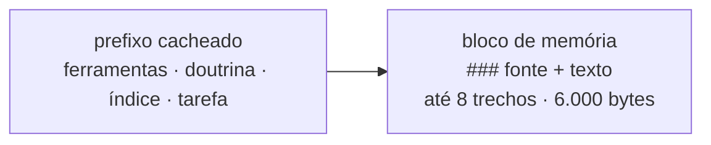

# FAB-604 · Entregar o contexto com a fonte citada

> ⬜ A fazer · Etapa **E6 — Memória do projeto** · Pacote 6.4 · História · R7

## A ideia

Os melhores trechos viram um bloco em que cada um cita a fonte, colocado depois da parte do prompt que o cache reaproveita.

## Visão geral



## O que foi feito

Monta o bloco de contexto recuperado: os melhores trechos do histórico do projeto, cada um com a fonte citada, para anexar ao despacho do agente. O bloco entra depois da parte cacheada do prompt e, sem trechos, o prompt não muda.

## Por que existe

Prepara R7 (o agente usa a memória do projeto com fonte): a citação permite conferir de onde veio a informação, e a posição preserva o cache.

## Como foi feito

- `Factory.Memory.Context.build/3` busca e limita a `max_chunks/0` trechos e `max_bytes/0` bytes
- O corte é sempre por trechos inteiros, do fim da lista; o primeiro (mais relevante) sempre entra
- `format/1` escreve a fonte de cada trecho; `append/2` só concatena ao prefixo, nunca o altera
- Nesta etapa nenhum despacho chama o bloco; na E7 `Factory.Dispatch.build/4` passa a anexá-lo por padrão (`memory: false` desliga)

**Exemplo:** um trecho aparece como `### _management/DECISIONS.md#6.2 — the database is the truth`, seguido do texto.

## Critérios de aceite

- [ ] O bloco cita a fonte de cada trecho
- [ ] Sem trechos, o prompt não muda
- [ ] O bloco fica fora da faixa cacheada

## Como verificar

```bash
mix test test/factory/memory/context_test.exs
```

## Onde está no código

`Factory.Memory.Context`
