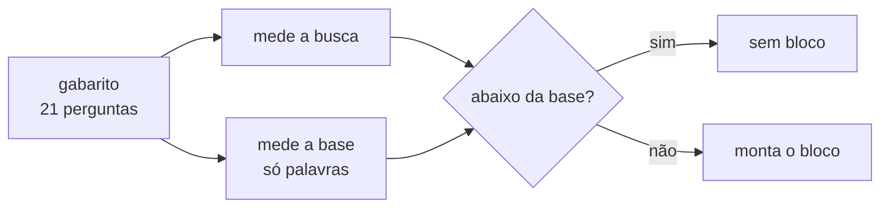

# FAB-605 · Avaliar a qualidade da busca

> ⬜ A fazer · Etapa **E6 — Memória do projeto** · Pacote 6.5 · História

## A ideia

Um gabarito de perguntas com resposta conhecida mede a busca; se ela ficar abaixo da busca só por palavra, o bloco de memória é desligado.

## Visão geral



## O que foi feito

Avalia a qualidade da busca com um conjunto fixo de perguntas de resposta conhecida, sobre um corpus de histórico de exemplo. Calcula recall@8, recall@1 e MRR para cada modo, e desliga o bloco de memória quando a busca fica abaixo da linha de base.

## Por que existe

Memória ruim é pior que nenhuma: contexto errado leva o agente a decidir errado com confiança. A medição também justifica o modo híbrido como padrão.

## Como foi feito

- `Factory.Memory.Evaluation` (em `priv/evaluation/questions.exs`) guarda o gabarito de perguntas e respostas esperadas
- Corpus de teste em `test/support/fixtures/evaluation_corpus/` (decisões, guia, progresso, tarefas)
- `measure_all_modes/2` mede os três modos; `baseline/2` é a linha de base só por palavra-chave
- `build_safe_context/3` desliga o bloco quando `below_baseline?/2` é verdadeiro ou a busca dá erro

**Exemplo:** se o recall@8 cair abaixo da linha de base, o despacho segue sem bloco de memória em vez de mandar trechos irrelevantes.

## Critérios de aceite

- [ ] Métricas calculadas sobre o conjunto de avaliação
- [ ] Abaixo da linha de base, o bloco não é enviado

## Como verificar

```bash
mix test test/factory/memory/evaluation_test.exs
```

## Onde está no código

`Factory.Memory.Evaluation` · `Factory.Memory.Search` · `Factory.Memory.Context`
