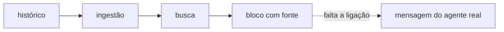

# FAB-606 · MARCO E6 — o agente cita a decisão anterior

> ⬜ A fazer · Etapa **E6 — Memória do projeto** · Pacote Marco · Marco · R7

## A ideia

Ver um agente real citar a decisão anterior com a fonte certa. As peças existem e estão testadas; falta a memória chegar à mensagem do agente.

## Visão geral

## O que foi feito

Marco da etapa 6, AINDA NÃO ATINGIDO (bloqueado): as peças da memória existem e estão testadas, mas a memória ainda não chega à mensagem do agente real.

## Por que existe

Provaria R7 com o modelo real. Está bloqueado porque a memória ainda não chega à mensagem que o agente real recebe.

## Como foi feito

- Na E6, nenhum código do despacho chama a memória, e a ingestão não é disparada sozinha
- Na E7, `Factory.Dispatch.build/4` passou a anexar o bloco ao texto do prefixo (`prefix.text`)
- Mas `Factory.Queue.Worker` monta a mensagem só com as faixas (`prefix.blocks`) e descarta o texto que leva a memória
- Para destravar: a fila usar o texto completo, disparar a ingestão e rodar um agente real numa tarefa cuja resposta está numa decisão anterior
- Nenhum arquivo foi entregue para este marco

## Critérios de aceite

- [ ] Agente real cita a decisão com a fonte
- [ ] Bloqueio: a memória ainda não chega à mensagem do agente real

## Onde está no código

`Factory.Memory.Context` · `Factory.Queue.Worker` · `Factory.Dispatch (E7)`
