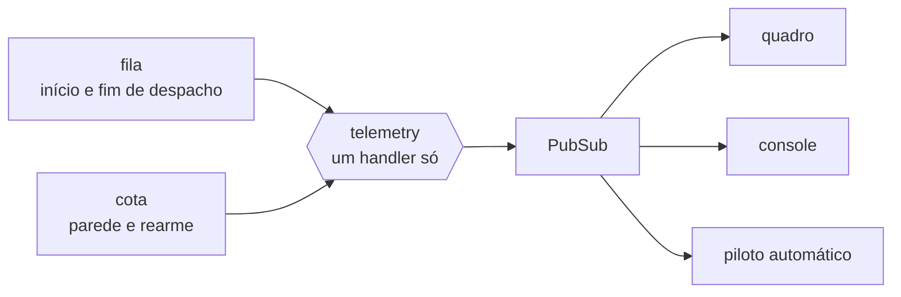

# FAB-701 · Medidas de cada execução

> ⬜ A fazer · Etapa **E7 — Painel e automação** · Pacote 7.1 · História

## A ideia

O motor avisa o que faz por eventos com nome, e quem precisa saber — a tela, o piloto — escuta, sem que o motor saiba quem está ouvindo.

## Visão geral



## O que foi feito

Cria o barramento de eventos do motor: início e fim de cada despacho, cada volta (tokens e custo), mudança de estado de tarefa e parede/rearme de cota. Quem quiser escuta esses eventos (telas, piloto) sem tocar no motor.

## Por que existe

A contabilidade não depende de alguém lembrar de registrar, e a tela lê exatamente os mesmos eventos que o motor produz.

## Como foi feito

- `Factory.Events` emite via `:telemetry.execute/3` (`dispatch_start/1`, `dispatch_turn/2`, `dispatch_stop/1`, `task_transition/1`, `quota_hit/1`, `quota_rearm/0`)
- `Factory.Telemetry.attach/0`, chamado na subida da aplicação, liga um único handler que repassa cada evento ao Phoenix.PubSub
- Assinantes usam `Factory.Events.subscribe/0`
- No caminho real já são emitidos: início e fim de despacho (fila) e parede/rearme (cota). A volta e a mudança de estado estão declaradas, mas o laço do agente e `Transition` ainda não as emitem — hoje só os testes e o botão Parar as produzem

**Exemplo:** ao fim de cada despacho a fila publica `[:factory, :dispatch, :stop]` com o número de voltas e o gasto; é esse evento que faz o piloto iniciar a próxima rodada.

## Critérios de aceite

- [ ] Todo despacho emite início e fim com o custo
- [ ] A tela lê os mesmos eventos do motor

## Como verificar

```bash
mix test test/factory/events_test.exs
```

## Onde está no código

`Factory.Events` · `Factory.Telemetry`
