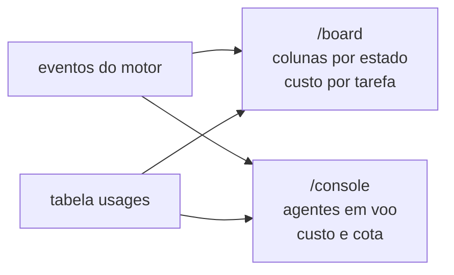

# FAB-702 · Quadro de tarefas e console ao vivo, com custo

> ⬜ A fazer · Etapa **E7 — Painel e automação** · Pacote 7.2 · História · R8

## A ideia

Duas páginas que se atualizam sozinhas a partir dos eventos do motor: o quadro mostra em que estado cada tarefa está e quanto custou; o console mostra quem está rodando agora.

## Visão geral



## O que foi feito

Cria as duas telas web ao vivo (Phoenix LiveView): o quadro de tarefas de um projeto, agrupado pelos estados do pipeline e com o custo de cada tarefa, e o console, que mostra os agentes em execução, as voltas do agente escolhido, o custo por tarefa e a parede de cota.

## Por que existe

Garante R8 (acompanhar o trabalho em tempo real com custo): o operador vê o que está acontecendo sem consultar o banco nem os logs.

## Como foi feito

- `FactoryWeb.BoardLive` (`/board`) assina `Factory.Events` e recarrega quando chega um evento de mudança de estado — sem consulta periódica
- `FactoryWeb.ConsoleLive` (`/console`) lista agentes em voo por `Factory.Agents.Supervisor.list/0`, com atualização periódica
- Custo por tarefa somado de `Factory.Tasks.Usage`, mostrando entrada / escrita de cache / leitura de cache / saída
- Parede de cota acompanhada pelos eventos `quota hit`/`rearm`
- Limite atual: como a mudança de estado e a volta ainda não são emitidas no caminho real, o quadro e o custo se atualizam ao abrir a página; ao vivo, por ora, só a lista de agentes em voo e a cota

**Exemplo:** no teste, um evento de mudança de estado faz o cartão trocar de coluna no quadro sem recarregar a página.

## Critérios de aceite

- [ ] O quadro muda sozinho quando a tarefa muda de estado
- [ ] O console mostra os agentes em execução, o custo por tarefa e a cota

## Como verificar

```bash
mix test test/factory_web/live/board_live_test.exs
mix test test/factory_web/live/console_live_test.exs
```

## Onde está no código

`FactoryWeb.BoardLive` · `FactoryWeb.ConsoleLive`
