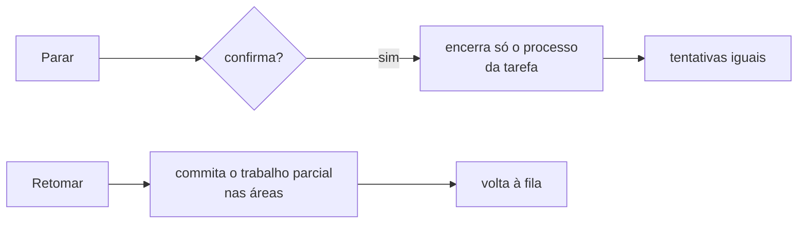

# FAB-703 · Parar e retomar

> ⬜ A fazer · Etapa **E7 — Painel e automação** · Pacote 7.3 · História

## A ideia

Interromper um agente não pode custar trabalho nem castigar a tarefa: parar mata só aquele processo e não conta ciclo; retomar guarda o que já foi feito e devolve a tarefa à fila.

## Visão geral



## O que foi feito

Cria o componente de tela com os botões Parar e Retomar de uma tarefa. Parar encerra só o processo supervisionado daquela tarefa; Retomar a devolve à fila, commitando antes o trabalho parcial feito nas suas áreas. O componente está testado, mas ainda não foi colocado em nenhuma página.

## Por que existe

Dá controle humano sem perder trabalho e sem punir a tarefa: uma parada do operador nunca gasta um ciclo.

## Como foi feito

- `FactoryWeb.Components.Controls` compõe dois mecanismos já testados
- Parar = `Factory.Agents.Supervisor.stop_agent/1` + evento com motivo `:stopped_by_operator`, sem passar por `Transition`
- Retomar = `Factory.Recovery.reconcile/1` restrito a UMA tarefa
- Parar pede confirmação (`request_stop` → `confirm_stop`)
- Falta montá-lo no quadro ou no console: hoje só o teste o renderiza

**Exemplo:** parar a tarefa 7 não toca nas tarefas 5 e 6, e o contador de tentativas da 7 continua igual.

## Critérios de aceite

- [ ] Parar encerra só o processo escolhido
- [ ] A tarefa parada pode ser retomada

## Como verificar

```bash
mix test test/factory_web/controls_test.exs
```

## Onde está no código

`FactoryWeb.Components.Controls` · `Factory.Agents.Supervisor` · `Factory.Recovery`
