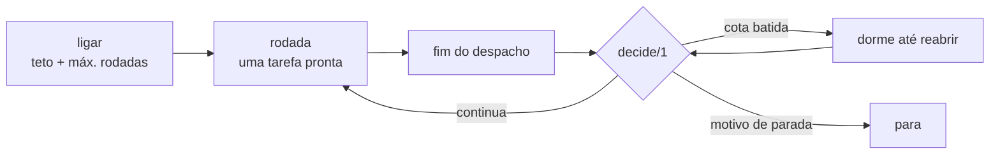

# FAB-704 · Rodadas automáticas com teto de gasto

> ⬜ A fazer · Etapa **E7 — Painel e automação** · Pacote 7.4 · História

## A ideia

Encadear rodadas sozinho, mas só com dois freios obrigatórios — teto de gasto e máximo de rodadas — e com a decisão escrita como uma tabela de regras em ordem, testada caso a caso.

## Visão geral



## O que foi feito

Cria o piloto automático: encadeia rodadas de trabalho sozinho até um critério de parada. Ligá-lo exige dois freios — teto de gasto total e número máximo de rodadas — e a decisão de continuar, dormir ou parar é uma função pura testada.

## Por que existe

Permite operar sem intervenção com gasto limitado. Desligar nunca corta trabalho em andamento, porque a decisão só é consultada ENTRE rodadas.

## Como foi feito

- `Factory.Autopilot.Decision.enable/2` exige os dois freios
- `decide/1` em ordem fixa: desligado → cota (dorme) → sem tarefa → replanejamento → 2 rodadas sem concluir → falha → teto → máximo de rodadas
- `Factory.Autopilot.Server.build_round/1` não tem algoritmo próprio: compõe `Exclusion.batch/2` (E5) com `Worker.dispatch/3`
- Uma rodada termina com o evento de fim de despacho da tarefa que o piloto disparou
- Estado persistido em JSON por projeto, sobrevive a reinício; `FactoryWeb.Components.Autopilot` é só a vista, ainda não colocada em nenhuma página

**Exemplo:** ao bater a cota, o piloto dorme até o horário de reabertura e rearma, em vez de contar a rodada como 'sem progresso'.

## Critérios de aceite

- [ ] A decisão de continuar é uma função pura testada
- [ ] Para por teto, falta de trabalho ou falta de progresso
- [ ] Cota batida faz dormir e rearmar, não parar

## Como verificar

```bash
mix test test/factory/autopilot/decision_test.exs
mix test test/factory/autopilot/server_test.exs
```

## Onde está no código

`Factory.Autopilot.Decision` · `Factory.Autopilot.Server` · `FactoryWeb.Components.Autopilot`
