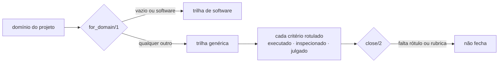

# FAB-705 · Entregas que não são código

> ⬜ A fazer · Etapa **E7 — Painel e automação** · Pacote 7.x · História

## A ideia

Nem toda entrega é código. O domínio do projeto escolhe a trilha, e todo critério precisa dizer como foi provado — executado, inspecionado ou julgado — para que nada seja pulado em silêncio.

## Visão geral



## O que foi feito

Cria a trilha genérica, para entregas que não são código (apresentação, documento, análise de dados). O domínio do projeto escolhe a trilha, e todo critério de aceite precisa sair rotulado com um grau de prova: executado, inspecionado ou julgado.

## Por que existe

Fora do software não há prova mecânica de graça; o rótulo obrigatório impede o verificador de pular em silêncio o critério que não sabe provar.

## Como foi feito

- `Factory.Tracks.for_domain/1`: `nil` ou `"software"` → `:software`; qualquer outro valor → `:generic`
- Os papéis (construtor, verificador, revisor) são os mesmos; só muda o agente que serve cada um (`agent/2`)
- `Factory.Criteria.ProofLevel.close/2` recusa fechar sem rótulo em todos os critérios
- `:judged` exige rubrica de itens binários na tarefa; `judged_ratio/1` mede quanto do projeto depende de julgamento
- Regras prontas e testadas; a fila ainda não as consulta (hoje todo projeto segue a trilha de software)

**Exemplo:** num projeto com domínio `apresentacao`, um critério 'slides legíveis' sem comando só fecha como `[judged]` se a tarefa tiver rubrica.

## Critérios de aceite

- [ ] Domínio do projeto escolhe a trilha
- [ ] Todo critério sai rotulado: executado, inspecionado ou julgado

## Como verificar

```bash
mix test test/factory/tracks_test.exs
```

## Onde está no código

`Factory.Tracks` · `Factory.Criteria.ProofLevel`
