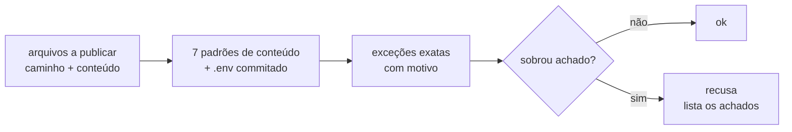

# FAB-706 · Busca de segredos antes de publicar

> ⬜ A fazer · Etapa **E7 — Painel e automação** · Pacote 7.5 · História

## A ideia

Um segredo vazado fica no histórico do git para sempre; por isso a varredura recusa, não só avisa, e cada exceção precisa de arquivo, trecho e motivo escritos.

## Visão geral



## O que foi feito

Varre o conteúdo que vai ser commitado ou publicado em busca de chaves de API e credenciais, e recusa quando encontra uma. Falsos positivos conhecidos são liberados um a um, com motivo registrado. A regra está pronta e testada; o commit automático ainda não a chama.

## Por que existe

O sistema commita sozinho; um segredo vazado fica no histórico do git e é praticamente irreversível — por isso aqui a regra recusa, não só avisa.

## Como foi feito

- `Factory.Security.scan/1` recebe a lista `{caminho, conteúdo}` e devolve `:ok` ou `{:refused, achados}` — sem terceira forma
- `patterns/0` lista os padrões: chaves de Anthropic, OpenAI, AWS, Google e GitHub, chave privada, senha em URL de conexão e arquivo `.env` commitado
- `allowed/0` perdoa só o achado exato (arquivo, padrão, trecho, motivo), nunca um padrão inteiro
- O módulo não lê disco nem decide o que será commitado; quem chama passa o conteúdo — e ainda falta ligá-lo ao commit (`Factory.Publishing.Git`)

**Exemplo:** um arquivo com algo no formato `sk-ant-...` volta como `{:refused, [...]}`, enquanto `.env.example` passa por ser modelo.

## Critérios de aceite

- [ ] Segredo conhecido no conteúdo a publicar é recusado
- [ ] Falso positivo comum não bloqueia

## Como verificar

```bash
mix test test/factory/security_test.exs
```

## Onde está no código

`Factory.Security`
