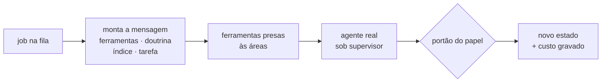

# FAB-707 · O agente real de ponta a ponta

> ⬜ A fazer · Etapa **E7 — Painel e automação** · Pacote Integração · História

## A ideia

Juntar as peças no caminho real: a fila pega a tarefa, monta a mensagem com a doutrina do papel, entrega ferramentas presas às áreas, sobe o agente e aplica o portão do papel ao resultado.

## Visão geral



## O que foi feito

Liga todas as peças no caminho real: o despacho do agente passa a ser montado a partir da tarefa e da doutrina escrita de cada papel (construtor, verificador, revisor), e a fila sobe o agente real com suas ferramentas, grava o resultado e aplica os portões. Inclui `mix factory.syntax`, que verifica a sintaxe de um arquivo Elixir sem executá-lo.

## Por que existe

Fecha o laço de ponta a ponta: sem esta integração, cada mecanismo funcionava isolado nos testes mas nenhum agente real passava por todos eles.

## Como foi feito

- `Factory.Dispatch.build/4` monta as quatro faixas do prefixo (ferramentas, doutrina, índice, tarefa) a partir da tarefa real
- Doutrinas por papel em `priv/doctrine/builder.md`, `verifier.md` e `reviewer.md`
- `Factory.Agents.Tools.build/4` liga cada nome do catálogo à função real, presa à raiz e às áreas da tarefa
- `Factory.Queue.Worker.perform/1` sobe `Agents.Loop` sob o supervisor e julga por papel; cota batida devolve o mesmo job à fila sem gastar tentativa
- Limite conhecido: o despacho anexa o bloco de memória ao texto, mas a fila monta a mensagem só com as faixas — o bloco não chega ao agente (é o que segura o marco da E6)
- Risco conhecido e declarado: a ferramenta `run` pode chamar `git` direto, contornando o commit restrito às áreas

**Exemplo:** `mix factory.syntax priv/probes/confinement_cli.exs` confirma que um probe que gastaria cota ao menos compila, sem rodá-lo.

## Critérios de aceite

- [ ] Construtor, verificador e revisor têm doutrina própria
- [ ] A fila despacha o agente real e grava o resultado
- [ ] Verificação de sintaxe sem executar o arquivo

## Como verificar

```bash
mix test test/factory/dispatch_test.exs
mix test test/factory/agents/tools_test.exs
mix test test/mix/syntax_test.exs
mix test test/factory/queue/worker_test.exs
```

## Onde está no código

`Factory.Dispatch` · `Factory.Agents.Tools` · `Factory.Queue.Worker` · `Mix.Tasks.Factory.Syntax`
