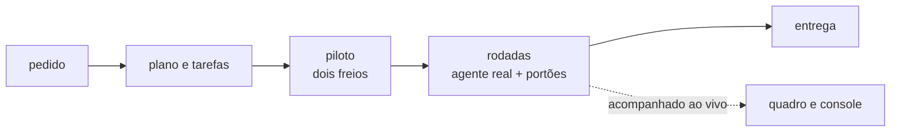

# FAB-708 · MARCO E7 — um projeto inteiro, sem intervenção, acompanhado na tela

> ⬜ A fazer · Etapa **E7 — Painel e automação** · Pacote Marco · Marco · R8

## A ideia

A prova final da tese: um projeto de teste inteiro, do pedido à entrega, conduzido pelo piloto com teto de gasto e acompanhado na tela — ainda não executado.

## Visão geral

## O que foi feito

Marco da etapa 7, EM ANDAMENTO (ainda não atingido): rodar um projeto de teste inteiro, do pedido à entrega, com uma única intervenção humana (o pedido), teto de gasto e custo acompanhado na tela. Essa execução ainda não foi feita.

## Por que existe

Provaria R8 e a tese como um todo: o sistema conduz um projeto real sozinho, sob as regras que estão no código.

## Como foi feito

- Caminho previsto: `mix factory.plan` gera as tarefas → piloto automático (`Factory.Autopilot.Server`) encadeia rodadas
- Acompanhamento em `FactoryWeb.BoardLive` e `FactoryWeb.ConsoleLive`, com teto em `Factory.Autopilot.Decision`
- Pendente: ligar os eventos de mudança de estado e de volta, para a tela acompanhar ao vivo
- Pendente: montar os componentes do piloto e de Parar/Retomar numa página
- Pendente: a fila enviar o bloco de memória (destrava o FAB-606)
- Pendente: autorização do teto de gasto da execução real, que consome cota
- Nenhum arquivo foi entregue para este marco

## Critérios de aceite

- [ ] Projeto de teste concluído sem intervenção
- [ ] Pendente: corretivas abertas e autorização do teto de gasto

## Onde está no código

`Factory.Autopilot.Server` · `Factory.Autopilot.Decision` · `FactoryWeb.BoardLive` · `FactoryWeb.ConsoleLive` · `Mix.Tasks.Factory.Plan`
